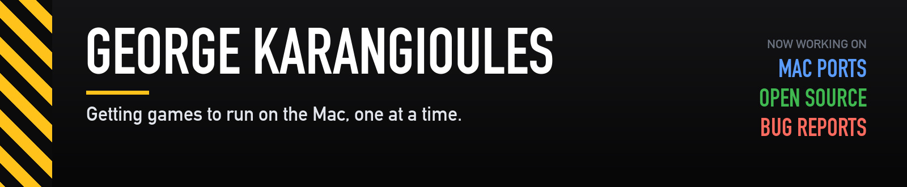
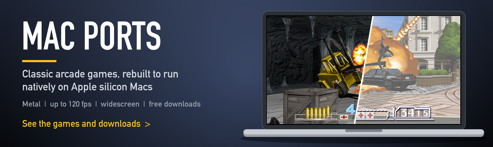
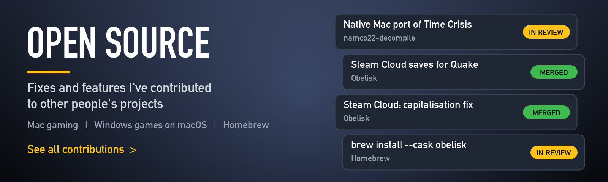
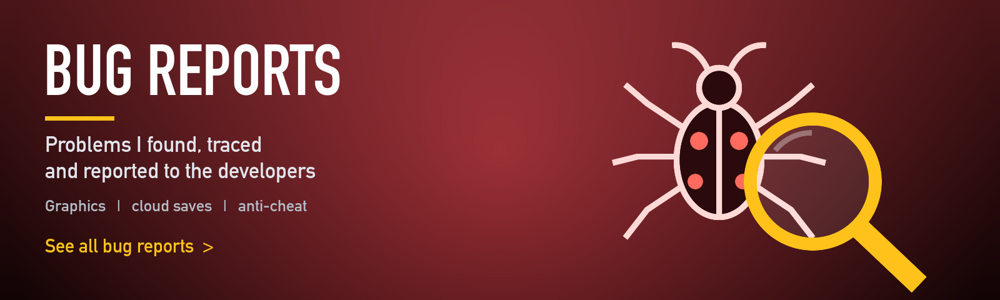

Disclaimer: these are unofficial fan projects, made in my free time. They are not affiliated with or endorsed by any game company, and no game files are shared here: you need your own copy of each game.

<a href="https://www.linkedin.com/in/george-karangioules-1207354b/">LinkedIn</a>

